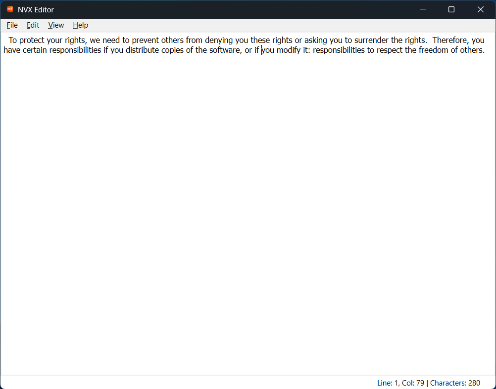
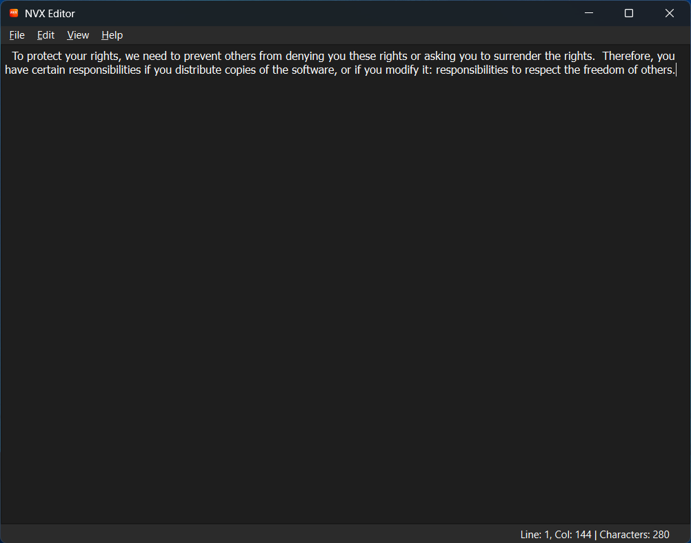

# NVX Editor

<div align="center">
  
  <p><i>A sleek, lightweight text editor built with Python and Qt.</i></p>
</div>

---


## Overview

NVX Editor is a desktop text editor built with Python and PyQt6.

It provides a straightforward interface for creating and editing plain-text files, with customizable appearance, file management, and essential editing tools.

## Features

## Screenshots

### Light Theme



### Dark Theme



### File Management
- Create, open, and save plain-text files.
- Access recently opened files.
- Print documents.
- Receive warnings before discarding unsaved changes.

### Text Editing
- Undo and redo changes.
- Cut, copy, paste, and delete text.
- Find text within a document.
- Enable or disable word wrapping.
- Zoom in and out.

### Customization
- Light and Dark themes.
- Customizable font family and size.
- Adjustable tab spacing.
- Persistent application settings.

### User Interface
- Full-screen mode.
- Status bar displaying line, column, and character count.
- Keyboard shortcuts for common actions.

## Requirements

- Python 3
- PyQt6

## Requirements

- Python 3
- PyQt6

## Installation

### Windows

1. Clone the repository:

   ```powershell
   git clone https://github.com/JasonRtz/nvx_editor.git
   cd nvx_editor
   ```

2. Create a virtual environment:

   ```powershell
   py -m venv .venv
   ```

3. Install dependencies:

   ```powershell
   .\.venv\Scripts\python.exe -m pip install -r requirements.txt
   ```

4. Run the application:

   ```powershell
   .\.venv\Scripts\python.exe main.py
   ```

## Running Tests

Install development dependencies:

```powershell
.\.venv\Scripts\python.exe -m pip install -r requirements-dev.txt
```

Run the automated tests:

```powershell
.\.venv\Scripts\python.exe -m pytest -v
```